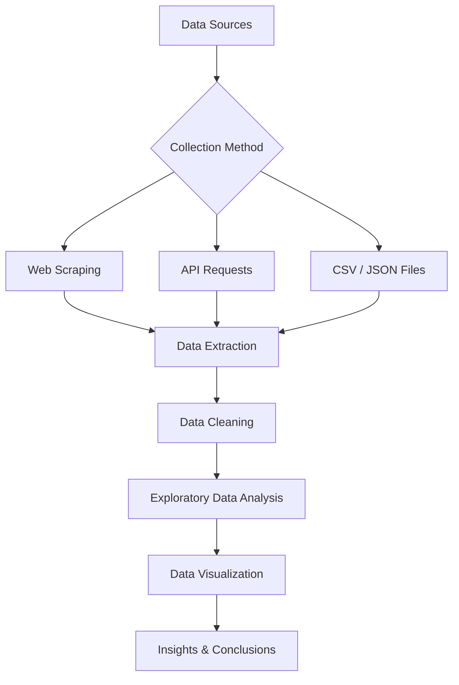

# DATA_Analysis 📊

## Description

**DATA_Analysis** is a Python repository focused on **Data Analysis, Web Scraping, and Data Collection**.

It contains practical exercises and projects involving extracting information from websites, working with APIs, cleaning datasets, performing Exploratory Data Analysis (EDA), and visualizing results.

## Technologies

- **Python 3** – Programming language
- **Requests** – HTTP requests and web scraping
- **BeautifulSoup** – HTML parsing and data extraction
- **Pandas** – Data manipulation and analysis
- **NumPy** – Numerical computing
- **Matplotlib & Seaborn** – Data visualization

## Project Workflow



## Main Topics

- **Web Scraping:** Extracting data from HTML pages.
- **APIs:** Retrieving and processing JSON responses.
- **Data Cleaning:** Handling missing values, duplicates, and incorrect data types.
- **EDA:** Discovering patterns, distributions, and correlations.
- **Visualization:** Creating informative charts and graphs.

## Installation

```bash
pip install requests beautifulsoup4 pandas numpy matplotlib seaborn
```

## Objectives

Develop practical skills in collecting, processing, analyzing, and visualizing real-world data using Python.

## Author

**Mateos Sharka**

Artificial Intelligence Student | Python | Data Analysis | Web Scraping