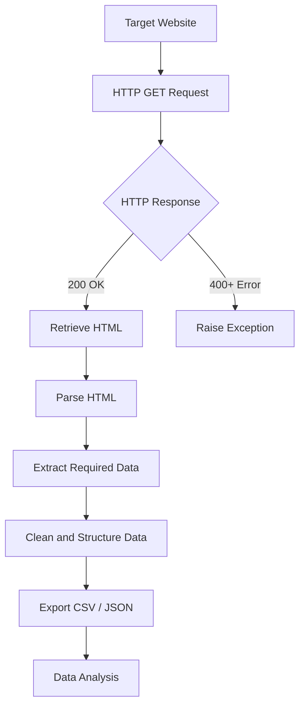

# Web Scraping 🌐

## Description

This directory contains Python scripts and exercises focused on **Web Scraping and Web Data Extraction**.

The goal is to learn how to retrieve information from websites, interact with HTTP requests, parse HTML documents, and transform extracted information into structured datasets for further analysis.

## Technologies

- **Python 3** – Main programming language
- **Requests** – Sending HTTP requests and retrieving web content
- **BeautifulSoup** – Parsing HTML and extracting information
- **JSON** – Handling structured data
- **Pandas** – Organizing scraped data into DataFrames

## Web Scraping Workflow



## Main Concepts

- **HTTP Requests:** Retrieving web pages using `requests.get()`.
- **HTTP Status Codes:** Handling successful responses and errors.
- **Headers:** Configuring requests with custom User-Agent values.
- **Timeouts:** Preventing requests from waiting indefinitely.
- **HTML Parsing:** Extracting elements, attributes, and text from HTML.
- **Data Extraction:** Collecting information from websites.
- **Data Storage:** Saving extracted information in CSV or JSON format.


## Installation

Install the required libraries:

```bash
pip install requests beautifulsoup4 pandas
```

## Learning Objectives

- Understand how websites communicate through HTTP.
- Retrieve and process HTML content.
- Handle HTTP errors, headers, and timeouts.
- Extract structured information from web pages.
- Prepare scraped data for further analysis.
- Follow website access policies and responsible scraping practices.

## Author

**Mateos Sharka**

Artificial Intelligence Student | Python | Web Scraping | Data Analysis