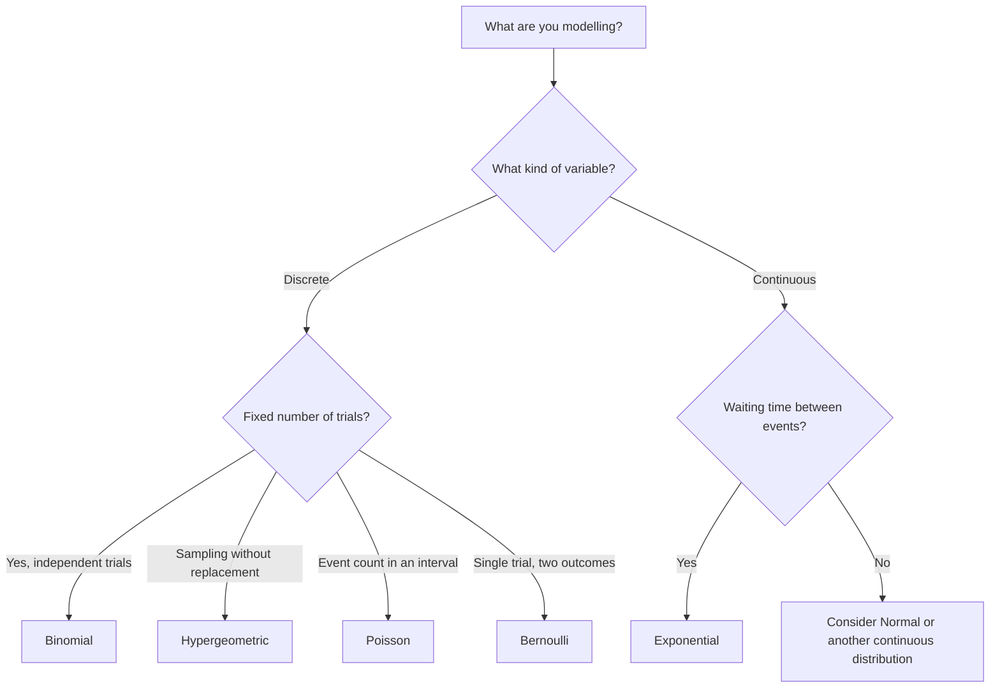
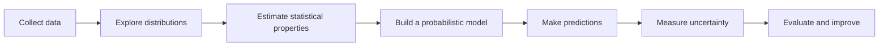

# Probability

Probability is the mathematical framework used to describe uncertainty and quantify how likely an event is to occur. In machine learning, probability helps us reason about data, model uncertainty, estimate outcomes, and build statistical models.

This section introduces the fundamental ideas of probability and common probability distributions used in data science and machine learning.

## Learning map

```mermaid
flowchart TD
    A["Probability"] --> B["Foundations"]
    A --> C["Random Variables"]
    A --> D["Probability Distributions"]
    A --> E["Statistical Relationships"]
    A --> F["Applications in Machine Learning"]

    B --> B1["Sample spaces and events"]
    B --> B2["Axioms and probability rules"]
    B --> B3["Conditional probability"]
    B --> B4["Bayes' theorem"]

    C --> C1["Discrete random variables"]
    C --> C2["Continuous random variables"]
    C --> C3["Expected value"]
    C --> C4["Variance and standard deviation"]

    D --> D1["Binomial distribution"]
    D --> D2["Poisson distribution"]
    D --> D3["Normal distribution"]
    D --> D4["Exponential distribution"]
    D --> D5["Hypergeometric distribution"]

    E --> E1["Covariance"]
    E --> E2["Correlation"]
    E --> E3["Independence"]

    F --> F1["Uncertainty estimation"]
    F --> F2["Bayesian reasoning"]
    F --> F3["Statistical modelling"]
    F --> F4["Model evaluation"]
```

## Core concepts

| Concept | Description | Why it matters |
|---|---|---|
| Experiment | A process that produces an outcome | Defines what is being studied |
| Sample space | The set of all possible outcomes | Establishes the possible results |
| Event | A subset of the sample space | Represents an outcome or group of outcomes of interest |
| Probability | A value between 0 and 1 that measures likelihood | Quantifies uncertainty |
| Conditional probability | The probability of an event given that another event occurred | Supports reasoning with available information |
| Independent events | Events where the occurrence of one does not change the probability of the other | Helps identify assumptions in statistical models |
| Random variable | A variable whose value depends on a random outcome | Converts outcomes into numerical values |
| Expected value | The long-run average value of a random variable | Describes its central tendency |
| Variance | Measures how spread out values are around the expected value | Quantifies uncertainty and dispersion |
| Standard deviation | The square root of variance | Expresses dispersion in the variable's units |

## Important probability rules

### Complement

The probability that an event does not occur is:

\[
P(A^c) = 1 - P(A)
\]

### Addition rule

For two events:

\[
P(A \cup B) = P(A) + P(B) - P(A \cap B)
\]

If the events are mutually exclusive, then \(P(A \cap B)=0\).

### Conditional probability

\[
P(A \mid B) = \frac{P(A \cap B)}{P(B)}, \quad P(B) > 0
\]

### Bayes' theorem

\[
P(A \mid B) = \frac{P(B \mid A)P(A)}{P(B)}, \quad P(B) > 0
\]

Bayes' theorem updates the probability of a hypothesis when new evidence becomes available.

## Random variables and distributions

A random variable assigns a numerical value to each outcome of a random experiment.

- **Discrete random variable:** takes countable values, such as the number of failures in a batch.
- **Continuous random variable:** can take any value in an interval, such as measurement time or temperature.

A probability distribution describes how probability is assigned to the possible values of a random variable.

### Common distributions

| Distribution | Type | Typical use |
|---|---|---|
| Bernoulli | Discrete | One trial with two possible outcomes |
| Binomial | Discrete | Number of successes in a fixed number of independent trials |
| Hypergeometric | Discrete | Sampling without replacement |
| Poisson | Discrete | Number of events in a fixed interval |
| Normal (Gaussian) | Continuous | Measurements and naturally aggregated variation |
| Exponential | Continuous | Waiting time between events in a Poisson process |

### Distribution selection map

The map is a learning aid, not a substitute for checking a distribution's assumptions.

## Expected value and variance

For a discrete random variable \(X\), with possible values \(x_i\) and probabilities \(p_i\):

\[
E[X] = \sum_i x_i p_i
\]

The variance is:

\[
Var(X) = E[(X - E[X])^2]
\]

An equivalent expression is:

\[
Var(X) = E[X^2] - (E[X])^2
\]

For a continuous random variable, sums are replaced by integrals over its probability density function.

## Probability in machine learning

Probability is used throughout the machine-learning workflow:

Examples include:

- Naive Bayes classification and Bayesian inference.
- Logistic regression, whose outputs can be interpreted as estimated class probabilities.
- Probabilistic forecasting and uncertainty estimation.
- Modelling event counts, waiting times, and measurement variation.
- Understanding sampling, noise, and the assumptions behind statistical tests.

## Projects

The exercises in this directory should be documented here as they are added. Use the table below to keep the README aligned with the actual repository contents.

| Project / exercise | Main topics | Directory |
|---|---|---|
| Probability fundamentals | Events, probability rules, conditional probability | `./` |
| Discrete distributions | Bernoulli, binomial, hypergeometric, Poisson | `./` |
| Continuous distributions | Normal and exponential distributions | `./` |
| Statistical properties | Expected value, variance, standard deviation | `./` |

> Update the table with the exact exercise names and directory paths from the repository. Do not treat these topic groups as separate completed projects unless the corresponding folders or tasks exist.

## Tools and environment

The exercises may use Python and scientific-computing libraries to calculate probabilities, work with distributions, and inspect results.

Typical tools for this subject include:

- **Python 3** — implementation and experimentation.
- **NumPy** — numerical operations and random sampling.
- **SciPy** — probability distributions and statistical functions.
- **Matplotlib** — visualizing probability distributions and results.

Use the versions and environment specified by the repository or the relevant exercise instructions. Do not assume that the versions above are installed.

## Recommended workflow

1. Read the exercise requirements and identify the probability concept being tested.
2. Write down the assumptions: discrete or continuous, independent or dependent, and the relevant sampling process.
3. Select the appropriate probability rule or distribution.
4. Derive the mathematical expression before implementing it.
5. Implement the solution in Python where required.
6. Test edge cases and compare numerical results with expected values.
7. Document the reasoning, formulas, and any assumptions.

## Where you will meet this again

| Topic | Related areas |
|---|---|
| Conditional probability and Bayes' theorem | Bayesian machine learning, Naive Bayes, diagnosis and classification |
| Binomial and Bernoulli distributions | Classification, binary outcomes, A/B testing |
| Poisson distribution | Event modelling, arrivals, incident counts |
| Normal distribution | Statistics, noise modelling, confidence intervals |
| Exponential distribution | Reliability, survival analysis, waiting-time models |
| Expected value and variance | Descriptive statistics, loss functions, risk and uncertainty |
| Covariance and correlation | Feature analysis, multivariate statistics, portfolio and time-series analysis |

## Author

**Mateos Sharka**  
Holberton School — Machine Learning

---

*This README is an introduction and navigation guide. The exact exercises, filenames, and project requirements are defined by the contents of the repository.*
