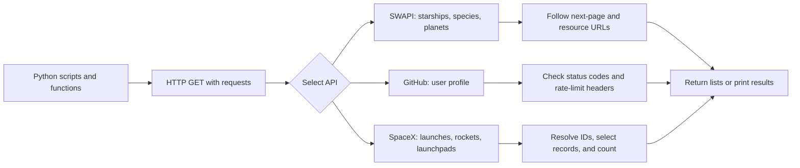
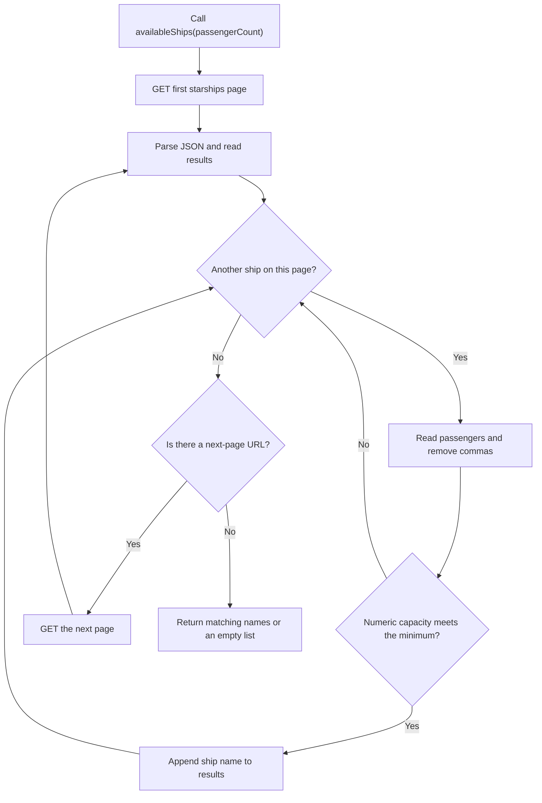

# API Data Retrieval and Transformation

## Overview

This project explores how to collect, process, and combine data from public **REST APIs** using Python. Instead of reading a local dataset, we send HTTP requests to external services, interpret their JSON responses, and transform the results into useful information.

The project uses three APIs:

- **Star Wars API (SWAPI):** explore starships, species, and planets.
- **GitHub REST API:** retrieve user information and handle HTTP errors and rate limits.
- **SpaceX API:** find upcoming launches and analyze launch counts by rocket.

The exercises progress from retrieving paginated results to joining related data across multiple endpoints.

## Learning Objectives

By completing this project, I aim to understand how to:

- Use the Python `requests` package to make HTTP `GET` requests.
- Interpret HTTP responses and status codes such as `200`, `403`, and `404`.
- Convert JSON responses into Python dictionaries and lists.
- Follow pagination to collect results spread over multiple pages.
- Handle API rate limits by inspecting response headers.
- Follow URLs and resource IDs to retrieve related data.
- Transform, filter, count, and sort information from external services.
- Read command-line arguments using `sys.argv`.

## How the Project Works

The project follows a common data-ingestion pattern: **send an HTTP request, inspect the response, collect the required records, and transform them into an answer**. The processing depends on the API and the task.



### Data Flow by Task

| Task | API data retrieved | Transformation | Result |
|---|---|---|---|
| 0 — Passengers | Paginated starship records | Filter by numeric passenger capacity | List of ship names |
| 1 — Sentience | Paginated species and linked planets | Select sentient species and resolve homeworlds | List of planet names |
| 2 — User location | GitHub user profile and response headers | Check status, location, and rate limit | Printed location or status message |
| 3 — First launch | Upcoming launches, rockets, and launchpads | Choose earliest upcoming launch and resolve IDs | Printed launch information |
| 4 — Rocket frequency | Launches and rocket records | Group by rocket and sort totals | Ranked rocket launch counts |

> GitHub renders the Mermaid diagram directly from this Markdown file; no image asset is required.

## Technologies

- Python 3
- `requests`
- REST APIs and JSON
- Ubuntu / Linux command line
- `pycodestyle` 2.11.1

> **Environment note:** The assignment instructions mention both Ubuntu 20.04 / Python 3.9 and Ubuntu 22.04 / Python 3.10. Follow the version required by your evaluator. The project avoids features that require newer Python versions.

## Project Structure

```text
APIs/
├── 0-passengers.py
├── 1-sentience.py
├── 2-user_location.py
├── 3-first_launch.py
├── 4-rocket_frequency.py
└── README.md
```

## Installation and Setup

1. Clone the repository and enter the project folder:

   ```bash
   git clone <your-repository-url>
   cd <your-project-folder>
   ```

2. Install the required package:

   ```bash
   python3 -m pip install requests
   ```

3. Make the Python scripts executable:

   ```bash
   chmod +x 0-passengers.py 1-sentience.py 2-user_location.py \
       3-first_launch.py 4-rocket_frequency.py
   ```

4. Run a script using `./filename.py` or `python3 filename.py`.

## Tasks

### 0. Starship Passenger Capacity

**File:** `0-passengers.py`  
**API:** [SWAPI](https://swapi.dev/)

Implement `availableShips(passengerCount)`, which returns the **names of starships able to carry at least the requested number of passengers**.

The function retrieves starship records, follows pagination, examines passenger capacities, and returns the matching names.

**Example:**

```python
#!/usr/bin/env python3
availableShips = __import__('0-passengers').availableShips
print(availableShips(10))
```

**Concepts:** `requests.get()`, JSON parsing, filtering, pagination.

#### Task 0: Pagination and Filtering Flowchart



The function processes **every ship on every page**. It skips nonnumeric passenger values (such as `unknown` or `n/a`) and only appends names when the capacity is at least `passengerCount`. When SWAPI has no more pages, the accumulated list is returned; if nothing matched, that list is `[]`.

### 1. Home Planets of Sentient Species

**File:** `1-sentience.py`  
**API:** [SWAPI](https://swapi.dev/)

Implement `sentientPlanets()`, which returns the **names of the home planets of sentient species**.

The function retrieves species across available pages, identifies sentient species, follows their `homeworld` links, and collects the planet names.

**Example:**

```python
#!/usr/bin/env python3
sentientPlanets = __import__('1-sentience').sentientPlanets
print(sentientPlanets())
```

**Concepts:** pagination, linked resources, combining API responses.

### 2. GitHub User Location

**File:** `2-user_location.py`  
**API:** [GitHub REST API](https://docs.github.com/en/rest)

The script accepts a GitHub user API URL as a command-line argument and checks the HTTP response:

- **200 OK:** display the user's location from the JSON response.
- **404 Not Found:** print `Not found`.
- **403 Forbidden due to rate limiting:** calculate and display the number of minutes until the rate limit resets, using the response headers.

**Example:**

```bash
./2-user_location.py https://api.github.com/users/holbertonschool
```

**Concepts:** `sys.argv`, HTTP status codes, `response.headers`, rate limits.

### 3. Next SpaceX Launch

**File:** `3-first_launch.py`  
**API:** [SpaceX API v4](https://github.com/r-spacex/SpaceX-API)

The script retrieves upcoming SpaceX launches, selects the earliest scheduled launch, and looks up the related **rocket** and **launchpad** information.

**Example:**

```bash
./3-first_launch.py
```

**Concepts:** date-based selection, resource IDs, fetching related records.

### 4. Rocket Launch Frequency

**File:** `4-rocket_frequency.py`  
**API:** [SpaceX API v4](https://github.com/r-spacex/SpaceX-API)

The script counts how many launches are associated with each rocket and prints the results **from highest launch count to lowest**.

It retrieves launch records, groups them by rocket ID, resolves rocket names, and sorts the counts.

**Example:**

```bash
./4-rocket_frequency.py
```

**Concepts:** aggregation, dictionaries, sorting, combining endpoints.

## Core API Concepts

| Concept | Python example | Purpose |
|---|---|---|
| Send a GET request | `requests.get(url)` | Retrieve a resource from an API. |
| Check the status | `response.status_code` | Determine whether the request succeeded. |
| Parse JSON | `response.json()` | Convert JSON into Python data structures. |
| Read headers | `response.headers.get("X-RateLimit-Reset")` | Inspect response metadata. |
| Follow pagination | `url = data.get("next")` | Continue requesting additional pages. |
| Read an argument | `sys.argv[1]` | Accept input from the command line. |

### Basic Request Example

```python
#!/usr/bin/env python3
"""Demonstrate a simple GET request to a public API."""

import requests


def get_user(username):
    """Return the GitHub user data for the given username."""
    url = "https://api.github.com/users/{}".format(username)
    response = requests.get(url, timeout=10)
    response.raise_for_status()
    return response.json()
```

### Pagination

Some APIs return only part of the dataset in each response. With SWAPI, the JSON response contains a `next` URL that points to the following page. Continue requesting pages until `next` is `None`.

```python
url = "https://swapi.dev/api/starships/"
all_starships = []

while url is not None:
    response = requests.get(url, timeout=10)
    response.raise_for_status()
    data = response.json()
    all_starships.extend(data["results"])
    url = data.get("next")
```

### Rate Limits

APIs may restrict how many requests a client can make in a given period. GitHub provides rate-limit information through HTTP headers, including `X-RateLimit-Remaining` and `X-RateLimit-Reset`. A `403` response may indicate a rate limit, but **not every `403` means rate limiting**. The response body and headers should be checked.

## Project Requirements

- Each Python file begins with `#!/usr/bin/env python3`.
- Every Python file ends with a newline and has executable permissions.
- Python code follows `pycodestyle` 2.11.1.
- Every module and function has a docstring.
- Tasks 2–4 are executable scripts and should use `if __name__ == "__main__":` to avoid running on import.
- The root project folder contains this `README.md`.

To check code style:

```bash
python3 -m pip install pycodestyle==2.11.1
pycodestyle *.py
```

## Useful References

- [Python Requests – Quickstart](https://requests.readthedocs.io/en/latest/user/quickstart/)
- [Star Wars API Documentation](https://swapi.dev/documentation)
- [GitHub REST API Documentation](https://docs.github.com/en/rest)
- [SpaceX API Documentation](https://github.com/r-spacex/SpaceX-API)
- [MDN – HTTP Response Status Codes](https://developer.mozilla.org/en-US/docs/Web/HTTP/Status)

## Conclusion

This project demonstrates a practical data-ingestion workflow: **request data, validate responses, follow pagination, fetch related resources, and transform raw JSON into meaningful results**. These are foundational skills for data engineering, data analysis, and machine learning pipelines.
